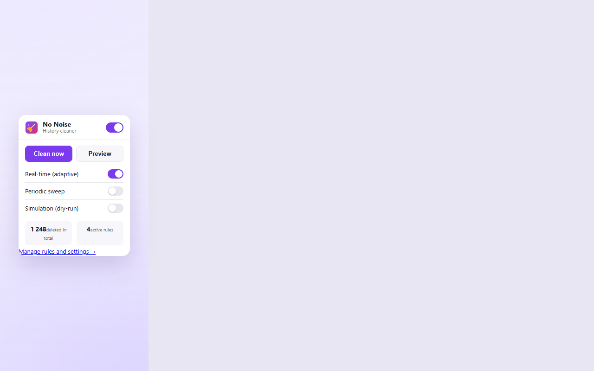
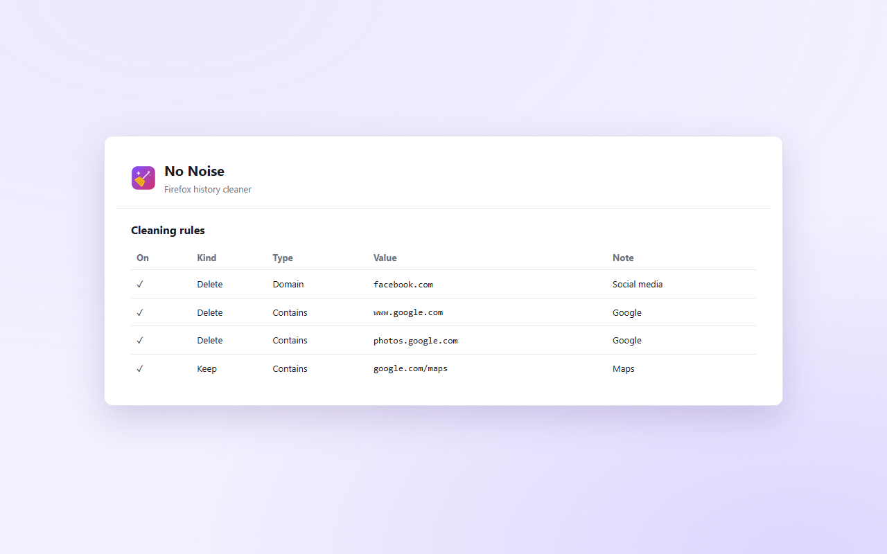
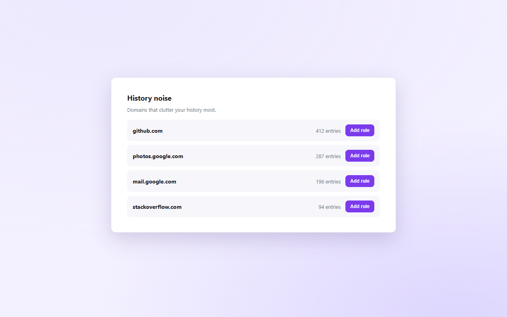
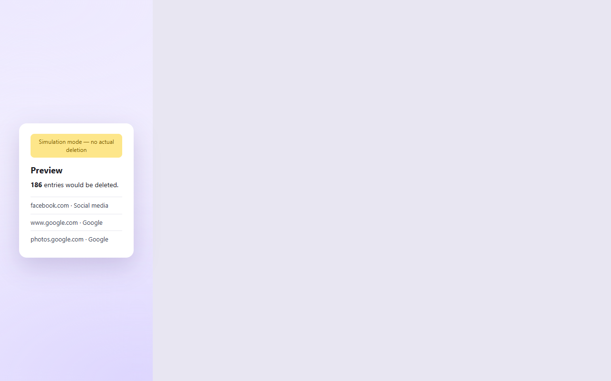

<p align="center">
  
</p>

<h1 align="center">No Noise</h1>

<p align="center">
  <strong>A Firefox extension that removes the recurring noise from your browsing history,<br>
  so the pages worth keeping rise back to the surface — entirely on your machine.</strong>
</p>

<p align="center">
  <a href="https://github.com/mister-guiiug/mister-no-noise/actions/workflows/ci.yml"></a>
  <a href="https://github.com/mister-guiiug/mister-no-noise/releases/latest"></a>
  
  
  
  
  <a href="LICENSE"></a>
</p>

<p align="center">
  <a href="https://addons.mozilla.org/firefox/addon/mister-no-noise@mister-guiiug/"><strong>Get it on Firefox Add-ons</strong></a>
  · <a href="https://github.com/mister-guiiug/mister-no-noise/releases/latest">Download the signed .xpi</a>
  · <a href="README.fr.md">Lire en français</a>
  · <a href="https://github.com/mister-guiiug/mister-no-prices">Sister extension: No Prices</a>
</p>

<table>
  <tr>
    <td></td>
    <td></td>
  </tr>
  <tr>
    <td align="center"><sub>Settings, one click away</sub></td>
    <td align="center"><sub>Delete and Keep rules</sub></td>
  </tr>
  <tr>
    <td></td>
    <td></td>
  </tr>
  <tr>
    <td align="center"><sub>History noise analyzer</sub></td>
    <td align="center"><sub>Preview in simulation mode</sub></td>
  </tr>
</table>

## Why

Browsing history is a second memory: when you cannot quite remember where you
saw something — a docs page, an article, a product — you search history and
find it. Until the signal drowns in noise.

Day after day the same handful of sites pile up: pull requests, photo albums,
identical searches, the same dashboards. None of those visits are worth
remembering, yet they bury the one page you care about.

Turning history off throws away the useful part. A cloud “helper” would read
your browsing. **No Noise** removes only the sites you choose — automatically,
as you browse — and never sends a byte off your machine.

## Features

- **Three cleaning modes**, combinable: real-time (adaptive), periodic sweep,
  and on demand — plus <kbd>Alt</kbd>+<kbd>Shift</kbd>+<kbd>C</kbd> and a
  right-click **“Add this site to No Noise”** menu.
- **Delete and Keep rules** — a Keep rule protects URLs even when a Delete rule
  matches (purge `google.com` but keep `google.com/maps`).
- **Four pattern types**: Contains, Domain (subdomains included), Wildcard
  (`*`), Regular expression.
- **Per-rule scheduling and retention**: always / real-time only / sweeps only,
  and optionally only entries older than N days.
- **History noise analyzer** — scan history, see the domains that clutter it
  most, turn each into a rule in one click.
- **Safety**: simulation (dry-run), confirmation before manual cleaning, warning
  above a configurable number of deletions.
- **Privacy-minded log**: domain names only by default (full URL or off are
  opt-in); notifications are optional.
- **URL tester**, statistics, JSON import/export (with merge/replace preview)
  and a plain-text pattern importer.
- **Fifteen languages**, on desktop and Android. 100 % local.

## Install

Firefox 140 or later on desktop, Firefox for Android 142 or later.

| Method | Lasts | How |
| ------ | ----- | --- |
| **Firefox Add-ons** (recommended) | permanent, auto-updates | open the [extension page](https://addons.mozilla.org/firefox/addon/mister-no-noise@mister-guiiug/) → *Add to Firefox* |
| **Signed file from a release** | permanent, auto-updates | open the `.xpi` of the [latest release](https://github.com/mister-guiiug/mister-no-noise/releases/latest) in Firefox |
| **Temporary, from source** | until Firefox restarts | `about:debugging#/runtime/this-firefox` → *Load Temporary Add-on…* → pick `manifest.json` |
| **With web-ext** | until the window closes | `npm install` then `npm start` |

## Privacy

**No data is collected.** The manifest declares it
(`data_collection_permissions: none`), and the code has no analytics, no
account and no ads.

- Rules, settings, log and statistics stay in Firefox (`storage.local`).
- The extension makes **no network request of its own**.
- Desktop notifications are requested only if you turn them on; the
  right-click menu can be disabled in the options.
- The log stores **domain names only** by default (full URL or off are
  opt-in).

## How it works

Rules live in local storage. The background page matches each visited URL
(and each sweep window) against compiled Delete / Keep patterns, with a
ReDoS guard on user regexes. Sweeps scan history in time windows and delete
in batches; a preview returns a short-lived token so “Clean now” does not
re-scan.

```
extension/src/common/core.js   rules, matching, storage, i18n
extension/src/background.js    real-time, sweeps, analyzer, menu, command
extension/src/popup/  options/
extension/_locales/            15 languages
amo/                           Firefox Add-ons listing texts and screenshots
```

## Languages

English, French, Spanish, German, Italian, Portuguese, Dutch, Polish,
Simplified Chinese, Japanese, Arabic (right-to-left), Korean, Turkish, Hindi
and Russian. The extension follows Firefox’s language.

Translations other than French and English have not yet been reviewed by
native speakers. Corrections are welcome: one file per language,
[`extension/_locales/<language>/messages.json`](extension/_locales).
See also [Maintaining](docs/MAINTAINING.md).

## Contributing

Issues and pull requests are welcome — a clearer rule UX, a translation fix,
a safer default.

**Adding a language**: copy `extension/_locales/en/messages.json` to
`extension/_locales/<code>/messages.json` and translate the `message` values (keep
placeholders). `npm test` checks that every locale has the same keys.

## Development

Requires Node.js 22 or later.

```bash
npm install
```

```bash
npm start            # Firefox with the extension, reload on change
```

```bash
npm test             # matching engine, ReDoS guard, locale parity
```

```bash
npm run lint         # Mozilla’s web-ext validation
```

```bash
npm run lint:js      # ESLint
```

```bash
npm run build        # .zip in web-ext-artifacts/
```

Continuous integration runs the tests, ESLint, `web-ext lint` and packaging
on every pull request.

## Releases

Bump `version` in `extension/manifest.json` and `package.json`, merge to `main`.
The publication workflow submits the version to Firefox Add-ons (`listed`). Once
Mozilla approves it, a GitHub release follows with the signed `.xpi`. Listing
copy and screenshots live in [`amo/`](amo/) — see [Maintaining](docs/MAINTAINING.md)
and [docs/AMO.md](docs/AMO.md).

## Known limitations

- History already deleted by Firefox retention policies cannot be recovered.
- A very large history may be scanned only in part; the UI reports it.
- Hostile regexes are skipped by the ReDoS guard; quadratic patterns on
  URL-sized inputs may still be slow.
- Chrome support (`manifest.chrome.json`) is experimental and needs PNG
  toolbar icons for a polished build.

## License

[MIT](LICENSE). An independent project, neither endorsed by nor affiliated with
Mozilla beyond the standard add-on review.
